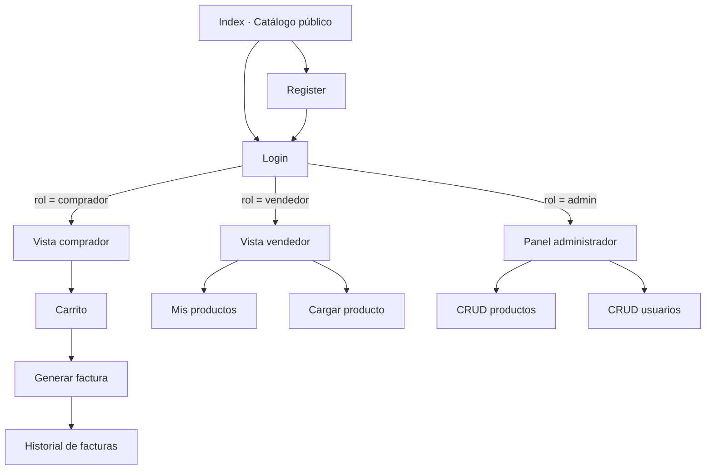
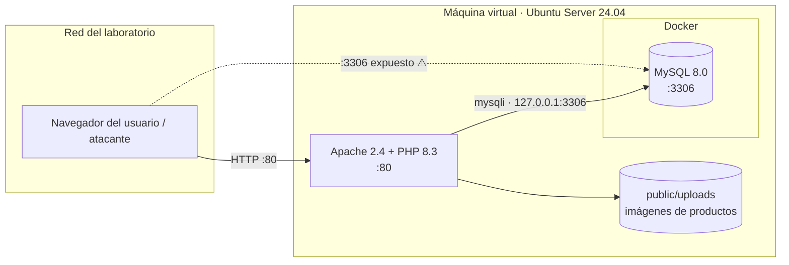
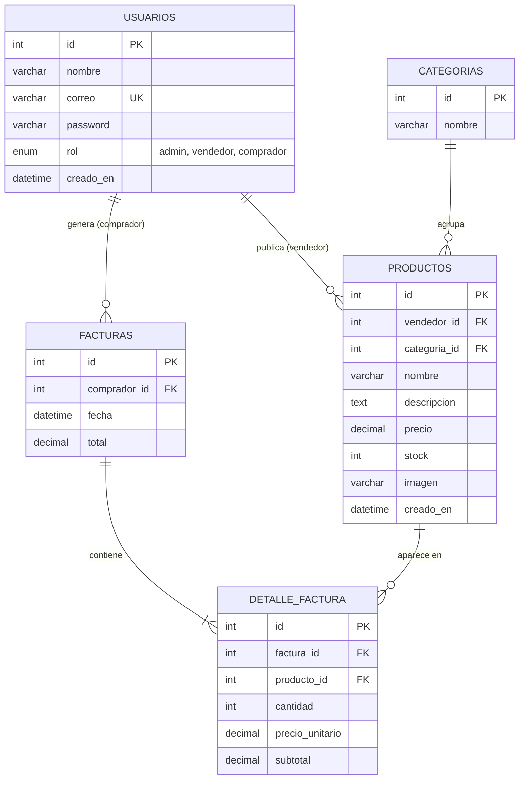

# 🔧 Ferretería El Tornillo — Aplicación web con vulnerabilidades controladas

> Proyecto académico del curso **Seguridad en entornos de desarrollo** — Universidad Centroamericana "José Simeón Cañas" (UCA).
> Aplicación web de una ferretería desarrollada en **PHP sin framework** y **MySQL**, con vulnerabilidades introducidas de forma deliberada y documentada para su explotación en un entorno de laboratorio controlado.

> ⚠️ **Advertencia:** esta aplicación es insegura **a propósito**. Debe ejecutarse únicamente dentro de una máquina virtual en la red del laboratorio. No la despliegues en internet ni en una red de producción.

**Integrantes:**

| Nombre | Carné |
|---|---|
| Gabriel Alejandro Batres Flores | 00103923 |
| Marden Eliuth Larios Orellana | 00029223 |
| Guillermo Alejandro Hernandez Dubon | 00106423 |
| Josue Eli Gomez Hernandez | 00074821 |
| Diego Alejandro Castro Recinos | 00182122 |

**Repositorio:** https://github.com/Gaba3/Anonymonos_Proyecto_SED

---

## Tabla de contenido

1. [Descripción del proyecto](#1-descripción-del-proyecto)
2. [Arquitectura](#2-arquitectura)
3. [Guía de instalación y despliegue](#3-guía-de-instalación-y-despliegue)
4. [Usuarios y credenciales de prueba](#4-usuarios-y-credenciales-de-prueba)
5. [Vulnerabilidades implementadas](#5-vulnerabilidades-implementadas)
6. [Flujo de trabajo en GitHub](#6-flujo-de-trabajo-en-github)
7. [Estado del proyecto](#7-estado-del-proyecto)

---

## 1. Descripción del proyecto

**Ferretería El Tornillo** es una tienda en línea de artículos de ferretería (herramientas, material eléctrico, plomería, pinturas y tornillería). Los visitantes pueden explorar el catálogo; los usuarios registrados pueden comprar y generar facturas; los vendedores publican productos y el administrador gestiona todo el sistema.

### Roles del sistema

| Rol | Acceso | Funcionalidades |
|---|---|---|
| **Público** (sin sesión) | Index, Login, Register | Ver el catálogo, buscar productos, registrarse e iniciar sesión. |
| **Comprador** | Vista de comprador | Seleccionar productos, agregarlos al carrito, generar una factura con el detalle de la compra y consultar su historial de facturas. |
| **Vendedor** | Vista de vendedor | Cargar productos (nombre, descripción, precio, stock, categoría e imagen) y ver los productos que ha publicado. |
| **Administrador** | Vista de administrador | CRUD completo de productos y de usuarios (incluido el cambio de rol). |

Todas las vistas restringidas por rol requieren una sesión iniciada; si un usuario intenta entrar a una vista que no corresponde a su rol, se le redirige al login.

### Flujo de navegación



---

## 2. Arquitectura

### Tecnologías

| Capa | Tecnología | Versión | Notas |
|---|---|---|---|
| Sistema operativo | Ubuntu Server LTS | 24.04 | Ejecutado en una máquina virtual (VirtualBox). |
| Servidor web | Apache HTTP Server | 2.4 | Con `mod_php`. |
| Lenguaje | PHP (sin framework) | 8.3 | Acceso a datos con la extensión `mysqli`, sin ORM. |
| Base de datos | MySQL | 8.0 | En un contenedor **Docker**. |
| Contenedores | Docker + Docker Compose | Repositorio de Ubuntu | Solo para la base de datos. |
| Interfaz | HTML5, CSS3, JavaScript, Bootstrap 5 | 5.3 | Bootstrap se incluye localmente en `public/assets/` (sin CDN). |
| Control de versiones | Git + GitHub | — | Flujo de trabajo GitFlow. |

**Tecnologías que no se usan, por restricción del proyecto:** frameworks con protecciones integradas (Laravel, Symfony, etc.), ORM o generadores de consultas, librerías de sanitización o seguridad, CMS y BaaS, y código vulnerable de terceros (DVWA, Juice Shop, etc.). Toda la lógica de autenticación, roles, productos y facturas está programada por el equipo.

### Diagrama de arquitectura



La aplicación PHP corre directamente sobre Apache en la VM y se conecta a MySQL, que corre en un contenedor Docker con el puerto 3306 publicado. La línea punteada representa la exposición intencional del puerto de la base de datos hacia la red (ver [sección 5](#5-vulnerabilidades-implementadas)).

### Modelo de base de datos



### Estructura de carpetas

```
ferreteria/
├── docker/
│   └── docker-compose.yml        # Contenedor de MySQL
├── database/
│   ├── 01_schema.sql             # Creación de tablas
│   └── 02_seed.sql               # Categorías, productos y usuarios de prueba
├── public/                       # DocumentRoot de Apache
│   ├── index.php                 # Catálogo público y buscador
│   ├── login.php
│   ├── register.php
│   ├── logout.php
│   ├── comprador/
│   │   ├── catalogo.php
│   │   ├── carrito.php
│   │   ├── factura.php           # Detalle de una factura
│   │   └── historial.php
│   ├── vendedor/
│   │   ├── mis-productos.php
│   │   └── cargar-producto.php
│   ├── admin/
│   │   ├── index.php             # Panel
│   │   ├── productos.php         # CRUD de productos
│   │   └── usuarios.php          # CRUD de usuarios
│   ├── uploads/                  # Imágenes subidas por vendedores
│   └── assets/
│       ├── css/                  # Bootstrap y estilos propios
│       ├── js/
│       └── img/                  # Logo e imágenes del sitio
├── includes/
│   ├── config.php                # Credenciales de conexión
│   ├── db.php                    # Conexión mysqli
│   ├── auth.php                  # Manejo de sesión y verificación de rol
│   ├── header.php
│   └── footer.php
├── server/
│   └── apache/
│       └── ferreteria.conf       # VirtualHost de Apache
├── install.sh                    # Script de instalación automatizada
└── README.md
```

---

## 3. Guía de instalación y despliegue

Tiempo objetivo de instalación: **menos de 20 minutos** (el laboratorio concede 30).

### 3.1 Requisitos de la máquina virtual

| Recurso | Valor |
|---|---|
| Hipervisor | VirtualBox 7.x |
| Imagen | `ubuntu-24.04.x-live-server-amd64.iso` |
| CPU | 2 vCPU |
| RAM | 2 GB (4 GB recomendado) |
| Disco | 20 GB |
| Red | Adaptador puente o según las indicaciones del docente — _pendiente de confirmar_ |

### 3.2 Crear la máquina virtual

1. En VirtualBox: **Nueva** → nombre `ferreteria-server`, tipo Linux, Ubuntu (64-bit).
2. Asignar los recursos de la tabla anterior y montar la ISO de Ubuntu Server.
3. Configurar el adaptador de red según las indicaciones del docente.
4. Instalar Ubuntu Server con las opciones por defecto y, cuando el instalador lo ofrezca, marcar **Install OpenSSH server**.
5. Crear el usuario del sistema (por ejemplo `ferreteria`) y reiniciar.
6. Verificar la IP asignada:
   ```bash
   ip a
   ```

### 3.3 Instalar paquetes

```bash
sudo apt update
sudo apt install -y apache2 php libapache2-mod-php php-mysql git docker.io docker-compose-v2
sudo systemctl enable --now apache2 docker
sudo usermod -aG docker $USER
newgrp docker
```

### 3.4 Clonar el repositorio

```bash
sudo git clone https://github.com/Gaba3/Anonymonos_Proyecto_SED.git /var/www/ferreteria
sudo chown -R $USER:$USER /var/www/ferreteria
cd /var/www/ferreteria
```

### 3.5 Levantar la base de datos

El contenedor carga automáticamente los scripts de `database/` la primera vez que se inicia (se montan en `/docker-entrypoint-initdb.d`).

```bash
cd /var/www/ferreteria/docker
docker compose up -d
docker compose ps          # Debe mostrar el contenedor de MySQL en estado "running"
```

> **Si la VM no tiene salida a internet:** la imagen se lleva preparada desde antes.
> ```bash
> # En un equipo con internet, antes del día de la entrega:
> docker pull mysql:8.0
> docker save mysql:8.0 -o mysql-8.0.tar
> # En la VM del laboratorio:
> docker load -i mysql-8.0.tar
> ```

### 3.6 Configurar la conexión

Revisar que `includes/config.php` apunte al contenedor:

```php
define('DB_HOST', '127.0.0.1');
define('DB_PORT', 3306);
define('DB_NAME', 'ferreteria');
define('DB_USER', 'ferreteria_app');
define('DB_PASS', '<definido en docker-compose.yml>');
```

### 3.7 Configurar Apache

```bash
sudo cp /var/www/ferreteria/server/apache/ferreteria.conf /etc/apache2/sites-available/
sudo a2dissite 000-default.conf
sudo a2ensite ferreteria.conf
sudo systemctl reload apache2
```

### 3.8 Permisos de la carpeta de imágenes

```bash
sudo chown -R www-data:www-data /var/www/ferreteria/public/uploads
sudo chmod 755 /var/www/ferreteria/public/uploads
```

### 3.9 Verificar el despliegue

```bash
curl -I http://localhost           # Debe responder HTTP 200
sudo ss -tulpn                     # Puertos en escucha
```

Desde otro equipo de la red del laboratorio, abrir en el navegador `http://<IP-de-la-VM>`.

### 3.10 Instalación automatizada

Los pasos 3.3 a 3.8 están reunidos en `install.sh`:

```bash
chmod +x install.sh
./install.sh
```

---

## 4. Usuarios y credenciales de prueba

Estos usuarios se crean con `database/02_seed.sql`.

| Rol | Correo | Contraseña |
|---|---|---|
| Administrador | `admin@eltornillo.local` | `Admin123` |
| Vendedor | `vendedor@eltornillo.local` | `Vendedor123` |
| Comprador | `comprador@eltornillo.local` | `Comprador123` |
| Comprador | `comprador2@eltornillo.local` | `Comprador123` |

**Base de datos (MySQL en Docker):**

| Usuario | Contraseña | Uso |
|---|---|---|
| `ferreteria_app` | _definida en `docker-compose.yml`_ | Conexión de la aplicación |
| `root` | _definida en `docker-compose.yml`_ | Administración del contenedor |

---

## 5. Vulnerabilidades implementadas

| # | Vulnerabilidad | Nivel | Ubicación |
|---|---|---|---|
| V1 | Inyección SQL (SQLi) | Código | `public/login.php`, `public/index.php` (buscador) |
| V2 | Puertos abiertos innecesarios | Servidor | `docker/docker-compose.yml` |
| V3 | IDOR (Insecure Direct Object Reference) | Código | `public/comprador/factura.php` |

### V1 — Inyección SQL

**Dónde se encuentra:**

- **Login** (`public/login.php`): el correo y la contraseña del formulario se insertan directamente en la consulta de autenticación.
- **Buscador del catálogo** (`public/index.php`): el término de búsqueda enviado por `GET` se inserta directamente en la consulta que lista los productos.

**Cómo se introdujo:** las consultas se construyen concatenando la entrada del usuario dentro de la cadena SQL y se ejecutan con `mysqli_query()`, sin sentencias preparadas (`prepare` / `bind_param`) ni escape de caracteres especiales.

```php
// public/login.php — consulta vulnerable (intencional)
$correo   = $_POST['correo'];
$password = $_POST['password'];
$sql = "SELECT id, nombre, rol FROM usuarios
        WHERE correo = '$correo' AND password = MD5('$password')";
$resultado = mysqli_query($conn, $sql);
```

```php
// public/index.php — buscador vulnerable (intencional)
$q = $_GET['q'] ?? '';
$sql = "SELECT id, nombre, descripcion, precio, imagen FROM productos
        WHERE nombre LIKE '%$q%'";
```

**Consideraciones de diseño:** los mensajes de error de MySQL se muestran en pantalla para facilitar la identificación de la vulnerabilidad durante la etapa de ataque.

**Mitigación (no aplicada a propósito):** usar sentencias preparadas con `mysqli_prepare()` y `bind_param()`, almacenar contraseñas con `password_hash()` / `password_verify()` y ocultar los errores de base de datos al usuario.

### V2 — Puertos abiertos innecesarios

**Dónde se encuentra:** `docker/docker-compose.yml`.

**Cómo se introdujo:** el puerto 3306 del contenedor de MySQL se publica en todas las interfaces de la VM (`0.0.0.0`) en lugar de limitarlo a `127.0.0.1`. La aplicación solo necesita acceder a la base de datos de forma local, por lo que esta exposición es innecesaria y permite conectarse a MySQL directamente desde cualquier equipo de la red del laboratorio.

```yaml
# docker/docker-compose.yml — exposición intencional
services:
  db:
    image: mysql:8.0
    ports:
      - "3306:3306"        # Debería ser "127.0.0.1:3306:3306"
```

**Detalle adicional:** Docker escribe sus propias reglas de `iptables`, por lo que un puerto publicado queda accesible aunque el firewall `ufw` esté activo y no lo permita.

**Puertos de la VM:**

| Puerto | Servicio | ¿Necesario? |
|---|---|---|
| 22/tcp | SSH | Sí, para administración |
| 80/tcp | Apache (aplicación) | Sí |
| 3306/tcp | MySQL (Docker) | **No** — expuesto intencionalmente |

**Mitigación (no aplicada a propósito):** publicar el puerto solo en loopback (`127.0.0.1:3306:3306`) o no publicarlo y conectar la aplicación por una red interna de Docker.

### V3 — IDOR en las facturas

**Dónde se encuentra:** `public/comprador/factura.php`, la vista que muestra el detalle de una factura a partir de su identificador en la URL (`factura.php?id=<número>`).

**Cómo se introdujo:** la página verifica que exista una sesión con rol de comprador, pero **no verifica que la factura solicitada pertenezca al usuario de esa sesión**. La consulta filtra únicamente por el `id` recibido, y los identificadores de factura son enteros consecutivos (`AUTO_INCREMENT`), por lo que son fáciles de predecir.

```php
// public/comprador/factura.php — control de acceso incompleto (intencional)
require_once '../../includes/auth.php';
requerir_rol('comprador');           // Solo valida el rol, no la propiedad

$id = (int) $_GET['id'];
$sql = "SELECT f.id, f.fecha, f.total, u.nombre, u.correo
        FROM facturas f
        JOIN usuarios u ON u.id = f.comprador_id
        WHERE f.id = $id";           // Falta: AND f.comprador_id = <usuario de la sesión>
```

**Datos expuestos:** cualquier comprador autenticado puede consultar las facturas de otros clientes, con su nombre, correo, fecha, productos comprados, cantidades y montos.

**Consideraciones de diseño:** el `id` se convierte a entero con `(int)`, de modo que este punto expone solo el IDOR y no se confunde con la inyección SQL de V1.

**Mitigación (no aplicada a propósito):** agregar a la consulta la condición `AND f.comprador_id = ?` con el ID del usuario guardado en la sesión, responder con `403` o `404` cuando la factura no le pertenezca, y opcionalmente usar identificadores no predecibles (UUID) en las URL.

---

## 6. Flujo de trabajo en GitHub

El repositorio sigue **GitFlow**.

| Rama | Propósito | Se crea desde | Se integra en |
|---|---|---|---|
| `main` | Versión estable de entrega | — | — |
| `develop` | Integración del desarrollo | `main` | `release/*` |
| `feature/*` | Una funcionalidad nueva | `develop` | `develop` |
| `release/*` | Preparación de una entrega | `develop` | `main` y `develop` |
| `hotfix/*` | Corrección urgente sobre producción | `main` | `main` y `develop` |

**Convenciones:**

- Nombres de rama: `feature/login`, `feature/catalogo`, `feature/crud-usuarios`, `release/1.0.0`, `hotfix/conexion-db`.
- Todo cambio entra a `develop` y a `main` mediante **Pull Request**, revisado por otro integrante.
- No se hacen commits directos a `main` ni a `develop`.
- Mensajes de commit descriptivos, con prefijo de tipo:
  - `feat:` nueva funcionalidad — `feat: agregar formulario de registro`
  - `fix:` corrección — `fix: corregir redirección por rol en login`
  - `docs:` documentación — `docs: actualizar guía de instalación`
  - `style:` diseño o formato — `style: aplicar paleta de colores al catálogo`
  - `chore:` configuración — `chore: agregar docker-compose para MySQL`
- Cada entrega se etiqueta en `main` (`v0.1.0` avance, `v1.0.0` entrega final).

---

## 7. Estado del proyecto

| Componente | Estado |
|---|---|
| README y arquitectura | ✅ Versión inicial |
| Base de datos en Docker (`schema` y `seed`) | ✅ Listo |
| Index (catálogo y buscador) | ✅ Listo |
| Login y Register | ⏳ Pendiente |
| Vista de comprador (carrito y facturas) | ⏳ Pendiente |
| Vista de vendedor | ⏳ Pendiente |
| Panel de administrador | ⏳ Pendiente |
| Script `install.sh` | ⏳ Pendiente |
| Prueba de instalación completa desde cero | ⏳ Pendiente |